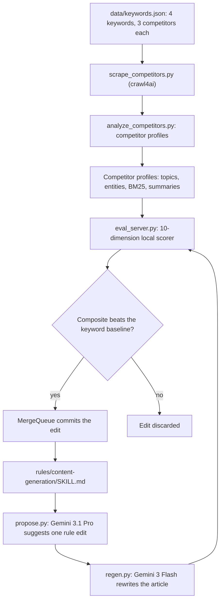

# RankLoop

Write SEO, AEO and GEO content from a playbook that improves itself: AI proposes each rule change, a local 10-signal scorer tests the rewrite against the live top 3 results, and only measurable wins are kept.

> Built by **Satya Janghu**, a digital marketing expert specializing in SEO, AI search, and organic growth marketing. [getsatya.com](https://getsatya.com) · [satya@getsatya.com](mailto:satya@getsatya.com)


## Why it exists

Most teams tune their AI writing prompts by feel. Someone reads a draft, adds a rule, and hopes the next article ranks better. Checking whether a change helped means comparing the article by hand against the pages that already rank, and that takes hours per keyword. RankLoop replaces the guesswork with a measured loop: every rule change is tested against real competitors on several keywords, and a change is kept only when the score goes up.

## What it does

- **Writes publish-ready long-form articles from one sentence.** The output is Markdown with YAML frontmatter, schema type, an AEO answer-first structure, EEAT signals and humanized prose, with no competitor URLs needed at write time.
- **Benchmarks every article against the live top 3.** Each test keyword is scored against 3 top-ranking public articles across 10 weighted signals: topic coverage, keyword relevance, corpus match, keyword profile, entities, entity relationships, narrative coverage, readability and structure, length, and banned words.
- **Improves its own rulebook.** A reasoning model proposes one edit at a time to a single ruleset, a fast model rewrites the article, and the edit is committed only if that keyword's composite score beats its baseline.
- **Tunes for universality, not one keyword.** The same ruleset is tuned across 4 keywords in different niches, with a separate baseline for each one, so the system builds general writing rules rather than overfitting a single topic.
- **Keeps going until it converges.** It restarts itself after a crash, resumes from a checkpoint, monitors its own health, and stops once every keyword has gone 10 iterations without a kept edit.
- **Ships a portable skill.** The tuned result is [`rules/content-generation/SKILL.md`](rules/content-generation/SKILL.md), a single Markdown file you can give to any LLM as its instructions.
- **Measures model choices instead of assuming them.** Built-in benchmarks compare generator models on speed and quality, so backend decisions rest on data.

## How it works



1. **Profile the competition.** `scrape_competitors.py` fetches the 3 public competitor articles for each keyword. `analyze_competitors.py` turns them into a profile: BERTopic topic clusters, BGE embeddings, a BM25 and TF-IDF corpus, KeyBERT keyphrases, GLiNER entities and their co-occurrence graph, BART summaries and readability statistics. A content hash skips the roughly 3-minute rebuild when nothing has changed.
2. **Propose.** For each keyword, a coordinator works in its own git worktree. It asks the reasoning model for one edit to `SKILL.md`, guided by that keyword's weakest scoring dimension.
3. **Regenerate.** The fast model rewrites the article from the edited ruleset. The output must have YAML frontmatter, at least 500 words and the completion sentinel in its last 3 lines.
4. **Score.** A warm GPU daemon scores the article on 10 dimensions, each normalized against the best competitor, and combines them into one composite.
5. **Gate and merge.** If the composite beats the keyword's baseline, a single serial merge queue commits the edit, so the rule history stays linear. Otherwise the edit is dropped. The loop only ever edits the rules; it never edits articles directly.

## Engineering highlights

- **A 10-dimension scorer that runs entirely on local models.** It uses BAAI/bge-large-en-v1.5 embeddings (fp16), the bge-reranker-v2-m3 reranker, GLiNER large v2.1 with 14 custom entity types, BART-large-CNN summaries, KeyBERT, BERTopic, rank-bm25, textstat and NetworkX. Weights are exact n/82 fractions (25, 10, 11, 5, 7, 3, 3, 8, 5, 5), and an assertion at import time checks that they sum to 1.0.
- **"Highest bar" scoring.** Entities are pooled across all competitors and every dimension compares against the strongest one. Example thresholds: reranker relevance blends 0.4 × strong (≥ 0.5) + 0.3 × moderate (≥ 0.3) + 0.3 × mean; the entity graph is 0.5 node overlap + 0.3 edge Jaccard + 0.2 density; length has a hard floor at 70% of the shortest competitor and a hard cap of 7,000 words; each banned phrase costs 0.03.
- **No fabricated scores.** Every dimension returns a real number between 0 and 1 or raises a `ScoringError`, which drops the iteration. Nothing silently falls back to a default.
- **Concurrency built for one GPU.** There is one coordinator thread per keyword, each in its own git worktree, and one serial commit thread. Workers run in their own process group and are killed as a group on stop. A lock-guarded close flag keeps shutdown of the merge queue orderly.
- **Multi-day resilience.** `run_until_done.sh` restarts after a crash with a backoff of 30 s × attempt (capped at 300 s) for up to 500 restarts, and logs each event as JSONL. A watchdog checks the daemon, free GPU memory (≥ 500 MiB), free disk (≥ 1 GiB) and state-file integrity, and raises an alert after 3 consecutive failed checks.
- **A warm scoring daemon.** A Unix socket with owner-only (0600) permissions serves newline-delimited JSON from one GPU-owning thread. Warmup takes about 20 s. GLiNER's first call takes 53.5 s cold and about 1.1 s warm. If the daemon is down, clients fall back to scoring in-process.
- **A safe score cache.** The cache key combines a SHA-256 of the content, the profile's mtime, pinned model versions and a weights epoch. Writes are atomic (temp file, then rename) under an exclusive `fcntl` lock, and race tests cover 4 processes × 50 writes.
- **A hardened Gemini backend.** Each call has a hard 1,200 s timeout enforced by a thread pool, and a cross-process `fcntl` rate gate spaces Pro calls 3.0 s apart to stay within its 25 RPM tier. Both models run at temperature 0.0, and Pro proposes with high thinking.
- **Benchmark-driven decisions** (in [`docs/benchmarks/`](docs/benchmarks/README.md)):
  - **Skill ablation.** The ruleset shrank from 17,026 words in 15 files to 2,533 words in 1 file (14.9% of the original size). After two targeted rule additions it came within 0.26% of the multi-phase average composite and beat it on 2 of 4 keywords. Regeneration time fell from roughly 800–900 s per article to 350–585 s.
  - **Generator choice.** Gemini 3 Flash took 0.51× the regeneration time of Claude Opus 4.6 (142.6 s vs 282.2 s) at about the same average composite (0.8406 vs 0.8394). Claude Sonnet 4.6 was 2.67× slower than Opus and was not adopted.
  - **Pipeline profiling.** A cross-keyword gate was using 55% of each batch (1,290 s). Removing it and moving to async coordinators raised the instrumented average composite from 0.8516 to 0.8666.
- **Test suite.** 68 pytest tests in 11 files cover scoring determinism, cache races, the merge gate, regeneration validation, profile freshness and the async supervisor. They run on CPU without a GPU or API key, with the model calls monkeypatched.

## Tech stack

| Layer | Technology |
|---|---|
| Language | Python 3.12+, Bash |
| Scoring models | PyTorch (CUDA), sentence-transformers (BGE embeddings and reranker), GLiNER, transformers (BART), KeyBERT, BERTopic with UMAP and HDBSCAN |
| Classic IR and NLP | rank-bm25, scikit-learn (TF-IDF), textstat, NetworkX, SciPy, NumPy |
| Generation | Google Gemini API (`google-genai`): `gemini-3.1-pro-preview` proposes, `gemini-3-flash-preview` writes |
| Scraping | crawl4ai |
| Orchestration | git worktrees, threads and process groups, a Unix-socket daemon, `fcntl` locks |
| Testing | pytest |
| Reference hardware | Linux with an NVIDIA GPU (built on an 8 GB RTX 2070 Super; about 5.5 GB of VRAM used after warmup) |

## Project evolution

**Started as** a 4-phase content ruleset (outline, draft, humanize, voice check) spread over 15 files, plus a scoring harness that benchmarked the output against the top-ranking articles for 4 test keywords: "seo for roofing", "seo for saas", "aeo vs seo" and "what is search intent".

**Became** an autonomous research loop in the style of Andrej Karpathy's autoresearch. The 15 files were consolidated into one compressed skill file after an ablation benchmark, the scorer grew to 10 competitor-normalized dimensions on local models, and generation moved to the Gemini API after a head-to-head model benchmark. The product is now the ruleset itself: a single portable skill, tuned against live competitors, that any LLM can follow.

## Roadmap

- Swap regeneration to a stronger generator (Gemini 3 Pro or Claude Opus 4.6) and re-establish baselines.
- Bring back the GEO-visibility and LLM-judge dimensions once reference content exists to validate them. Their code is kept but switched off.
- Add per-section narrative matching (pairing each section with its closest competitor section).
- Add more test keywords to make the rules more universal.
- Damp scoring noise with a judge ensemble or a median over repeat scores.
- Add a second GPU so merge-queue work can overlap with the workers.

## Running it locally

**Prerequisites:** Linux, an NVIDIA GPU, Python 3.12+ and a Gemini API key.

```bash
bash scripts/install_deps.sh          # creates .venv, installs requirements.txt, runs doctor.py --quick
cp .env.example .env                  # set GEMINI_API_KEY
source .venv/bin/activate

python scripts/scrape_competitors.py  # fetch the 12 competitor articles into data/competitors/ (gitignored)
python scripts/analyze_competitors.py # build data/profiles/ (about 3 min on GPU)
python scripts/evaluate.py content --config data/keywords.json --verbose

python scripts/parallel_loop.py --iterations 1 --establish-baselines
python scripts/parallel_loop.py --iterations 5 --dry-run   # infrastructure smoke test
bash scripts/run_until_done.sh                              # autonomous run
```

Run the tests with `pytest`. They need neither a GPU nor an API key.

To use the skill without the harness, give [`rules/content-generation/SKILL.md`](rules/content-generation/SKILL.md) to any LLM as its instructions, along with a one-sentence topic.

## Documentation

- [Architecture](docs/ARCHITECTURE.md): the problem statement, scoring model, weights and system design.
- [Runbook](docs/RUNBOOK.md): how to start, monitor, resume and roll back an autonomous run.
- [Decision log](docs/decisions.md): the design decisions and their reasoning.
- [Contributing](docs/CONTRIBUTING.md): rules for changing the scorer, the skill and the tests.
- [Benchmarks](docs/benchmarks/README.md): skill ablation, generator model comparisons and pipeline profiling.
- [Data](data/README.md) and [sample content](content/README.md): the keyword set and the benchmark articles.
- [Banned words](rules/content-generation/banned-words.md): the phrase list the scorer penalizes.

## About the author

> Built by **Satya Janghu**, a digital marketing expert specializing in SEO, AI search, and organic growth marketing. [getsatya.com](https://getsatya.com) · [satya@getsatya.com](mailto:satya@getsatya.com)

Satya holds content to a measurable bar, so SEO and AI-search decisions are benchmarked against what already ranks instead of resting on opinion.

## License

All rights reserved. See [LICENSE](LICENSE).
